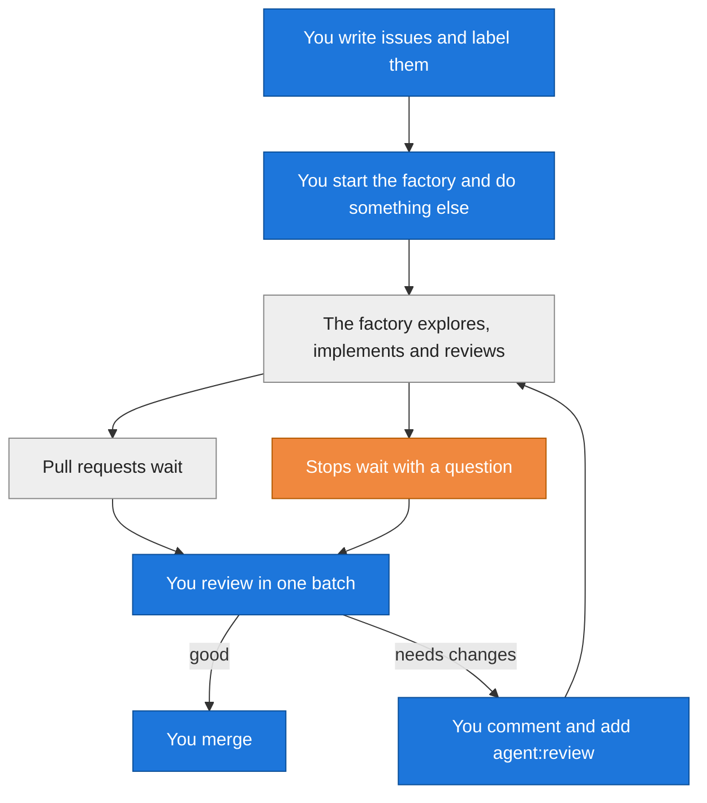
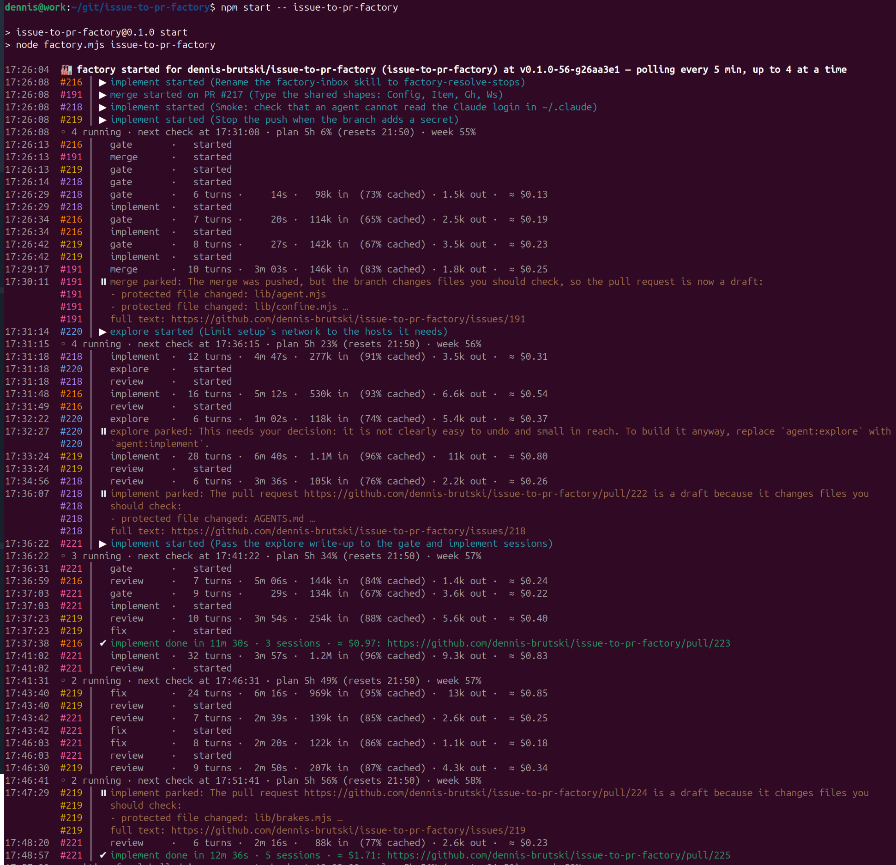
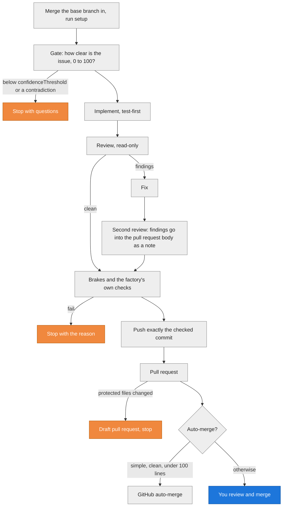
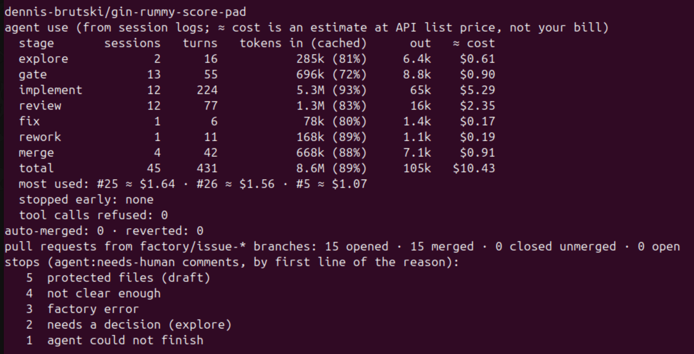

# issue-to-pr-factory
[](https://github.com/dennis-brutski/issue-to-pr-factory/actions/workflows/ci.yml?query=branch%3Amain) [](https://github.com/dennis-brutski/issue-to-pr-factory/actions/workflows/ci.yml?query=branch%3Amain)

A software factory for a single maintainer (for now). It turns labelled GitHub issues into checked pull requests, with Claude Code agents confined in a sandbox.

You write issues, label them, start the factory and do something else. The factory runs the agents. You come back and review and merge pull requests and answer comments in one batch.

Two hard guarantees:
- **It runs only while you have started it.** No service, no schedule, no webhook.
- **It never pushes to the base branch.** It pushes `factory/issue-<n>` branches only. It never merges either, unless you turn on `autoMerge` (see *How a run works*).

The factory has no dependencies: Node's standard library, `gh`, `git`, `bwrap` and `claude`. There is nothing to `npm install` to run it; `npm ci` only adds the tools for working on it (lint, type check).

## A day with the factory



Blue is you, grey is the factory, orange is a stop.



## Trust model

- **Trusted:** the base commit GitHub reports, your review, and the confinement.
- **Assumed hostile:** issue text, agent output, and branch code until the checks pass.
- Treat issue text as untrusted input: it goes into every prompt.
- Only labels and comments by you count; anyone else's are ignored.

## ⚠ Risks you accept

- ⚠ Agents run Claude Code with your login (`~/.claude`) and spend your Claude plan.
- ⚠ After a push, unchanged CI workflows run the branch's code on GitHub's machines.
- ⚠ With `autoMerge`, auto-merged code reaches the base branch before you read it. Read the merged pull requests afterwards and revert what you do not like.
- ⚠ With two runs at once, one run's agent can change the shared clone's git config just before the factory's git reads it for the other run. Whatever that config makes git run stays confined, and the push goes out from the factory's own clone, but in that window it can change what git reports to the brakes. The next check stops the factory.
- ⚠ Setup has network and runs code from the branch (install scripts, for example) that you have not read.
- ⚠ The sandbox is only as good as `bwrap` and Claude Code's sandbox.

What the factory does about it: see *Confinement and brakes* below. To report a way out of the confinement, see [`SECURITY.md`](SECURITY.md).

## Getting started

You need:
- **Linux with `bwrap`** (bubblewrap), with unprivileged user namespaces allowed. `bwrap --ro-bind / / --dev /dev true` must succeed.
- **`socat`**, which Claude Code's sandbox needs on Linux next to `bwrap` (see its docs). Without it every agent session fails; `npm run smoke` shows it.
- **Node.js 26 or newer.** If Node lives in your home folder but not in `~/.nvm` (fnm, volta, `~/.local`), add that folder to `runtimeRead` in `local.mjs` (step 1).
- **Claude Code** (`claude`), logged in with your Claude account, with access to the models in `config.mjs`.
- **`gh`**, logged in as you (`gh auth login`). For a **private repo**, also run `gh auth setup-git`: the factory clones, fetches and pushes over https.
- **A git identity** (`git config --global user.name` and `user.email`).

Then:
1. Create `local.mjs` next to `config.mjs` for your own settings. It is git-ignored and goes over `config.mjs`; the file for one repository (step 2) goes over both.
   ```js
   export default { owner: 'your-github-login', ownerName: 'Alex' };
   ```
   `owner` is your GitHub login: only labels and comments by that account count, and `gh` must be logged in as it. The factory does not start without it. In the rest of this README, "you" means the owner. `ownerName` is what the agents call you.
2. Write `targets/<name>.mjs` for your repository, a **target** (fields under *Targets*). Targets are git-ignored, like `local.mjs`. A minimal one:
   ```js
   export default {
     repo: 'you/your-repo', baseBranch: 'main',
     setup: [['npm', ['ci', '--ignore-scripts']]],         // with network, before the first agent session
     checks: [['npm', ['test']]],                          // without network, before every push
     testDirs: ['test/'],                                  // changing an existing test here makes a draft
     protectedFiles: ['package.json', 'package-lock.json'], // so does changing these
     env: { npm_config_cache: '{runDir}/npm-cache' },      // the npm cache stays in the run folder,
     setupWrite: ['{runDir}/npm-cache'],                   // not in your own ~/.npm
   };
   ```
   Setup has network, checks have none, and `--ignore-scripts` stops install scripts from running unread code with network.
3. Give your repo an `AGENTS.md`: how to run its tests, where things go, its rules. Copy [`.github/ISSUE_TEMPLATE/agent-task.md`](.github/ISSUE_TEMPLATE/agent-task.md) into the target repo at the same path, so issues come with acceptance criteria.
4. Run `npm run smoke` once, and `npm run smoke:checks -- <name>` for each target. Each runs one real agent session (uses your Claude plan).
5. `npm start -- <name>`.
6. Day to day: write an issue as clearly as for a colleague, add `agent:implement` (or `agent:explore` when unsure), and do something else. It ends in a pull request (`agent:done`) or a stop (`agent:needs-human`, with a comment saying why).

## Use

```sh
npm start                          # the only target, when there is just one
npm start -- my-app                # one factory per target; several can run side by side
npm run start:local my-app         # agents on a local model instead of Claude (`local` in local.mjs, under Targets)
```

- With several targets, name one (or it says `choose a target: <names>`); a second start of a target says `already running (pid <n>)` unless the process holding `runs/<target>/factory.lock` died.
- **Ctrl-C** stops picking up work and lets running agents finish.
- **Ctrl-C again** kills them at once. Their commits are kept and resume on the next start; uncommitted changes stop the issue.

## Labels

You set one of these. Only labels **you** applied count.

| Label | On | What happens |
|---|---|---|
| `agent:explore` | issue | A write-up is posted. If the change is easy to undo and small, it moves on to implement by itself. |
| `agent:implement` | issue | It is built test-first, reviewed, checked, and opened as a pull request. |
| `agent:review` | pull request | **Rework:** an agent session addresses your comments since the branch's last commit, answers in a 🏭 Rework comment, and the change is checked and pushed. The label is removed when done. On a stop it stays; removing `agent:needs-human` runs the rework again. |
| `agent:merge` | pull request | The base branch is merged in and conflicts are resolved. The label is removed when done. The factory also does this by itself, without the label, when one of its own pull requests conflicts with the base branch. |

The factory sets these:

| Label | Meaning |
|---|---|
| `agent:in-progress` | A run is working on it right now. Removed when the run ends, whatever the outcome; after a kill or crash, removed on the next start. |
| `agent:needs-human` | Stopped. The newest factory comment says why. **Remove this label to try again.** |
| `agent:done` | The pull request is open. |

Comments you write on a labelled issue or pull request are instructions for the agent's next run, its review and its fix step. The factory's own comments start with 🏭 and are not passed on as requests.

## How a run works



- **Polling:** every `pollSec` it lists labelled issues and pull requests, oldest first, and runs up to `maxParallel` at a time. An issue that lists issues under `## Depends on`, one `- #<n>` each, or is blocked by open issues in GitHub's *Relationships* (blocked-by links), waits until all of them are closed; the terminal says once what it waits for (`#160 waits for #151, #152`).
- **Conflicts:** its own unlabelled pull requests (`factory/issue-<n>`, opened by you) that conflict get a `merge` run, as with `agent:merge`.
- **Worktree:** one per issue, `runs/<target>/worktrees/issue-<n>`, shared by its pull request; the base is merged in (never rebased) before `explore` and `implement`, and it is removed when the issue or pull request closes.
- **Setup** runs confined, with network, before each run's first session, since agents have no network.
- **Port:** each run gets one free port for setup, sessions and checks.
- **Explore:** one read-only session writes up the cause or the shape of the change, the files it touches and its side effects. It needs no network: it reads the code and history, and can run the tests in its sandbox to reproduce a bug. If it judges the change easy to undo (one `git revert`) and small in reach, it swaps `agent:explore` for `agent:implement`; otherwise it stops for your decision. The gate and implement sessions that follow get your newest write-up.
- **The gate:** the first step of `implement`. A read-only session scores how clearly the issue can be built as written, from 0 to 100. Below `confidenceThreshold` (70), or when it finds statements in the issue that cannot all hold, it stops with its questions (and any contradictions, and files the issue names that do not exist). It also rates the difficulty (`simple`, `normal`, `hard`): a `simple` issue gets its first draft from `simpleModel`, unless it is likely to touch protected files or the last run stopped. Review and fixes always use `model`.
- **Implement:** implement → review (read-only) → fix, if there were findings → the brakes and the factory's own checks → push of exactly the checked commit → pull request. The pull request is a **draft** only when the branch changes protected files; the run then stops so you read that part. Mark it ready yourself after reading; the factory never does. Removing `agent:needs-human` from the issue starts another implement run on the same branch.
- **Auto-merge:** with `autoMerge: true`, an `implement` run calls `gh pr merge --squash --auto` on its pull request, and says so in a comment, only when all of these hold:
  - the target has `heldOutChecks` (the agent can read and change the target's `checks`, so they alone could be bent until they pass);
  - the pull request is not a draft;
  - it lists no tests that pass without the change (see `testFiles`);
  - the gate rated the issue `simple`;
  - the review was clean, or it had findings, the fix finished and a second review after the fix was clean (the second review always runs after a fix; its findings start no second fix but go into the pull request body under `## Review findings after the fix`);
  - fewer than 100 lines changed (additions + deletions, as GitHub counts them).

  `agent:review` and `agent:merge` runs never auto-merge. Otherwise the terminal line says which one failed (`not auto-merged: …`), with no comment. If GitHub refuses (auto-merge not allowed in the repo settings, or anything else), a comment says why and asks you to merge it by hand; the run still ends `done`. With required checks, GitHub waits for them.
- **Retry:** the steps that change code (`implement`, `fix`, `rework`, `merge`) are told why the last run stopped: the newest "Factory stopped" comment since the last commit, marked as information. Gate, review and explore judge without it.
- **Brakes:** what stops a push or makes the pull request a draft is under *Confinement and brakes*.

## When it stops (`agent:needs-human`)

| The comment says | What to do |
|---|---|
| not clear enough to build without guessing | Answer the questions in a comment, remove the label. |
| needs your decision: not clearly easy to undo and small in reach | Read the write-up; the implement run gets it too. To go ahead, swap `agent:explore` for `agent:implement` and remove the label. |
| the agent could not finish / produced no changes | Read what is missing; sharpen the issue or do it by hand. |
| no new comments from you since the last push | `agent:review` found nothing to address. Write your comments, then remove the label. |
| the worktree has uncommitted changes | A run was killed mid-session. Commit or discard the changes in `runs/<target>/worktrees/issue-<n>`, remove the label. |
| the branch conflicts with the latest base | Merge the base branch in by hand in the worktree, remove the label. |
| a check failed / setup failed | The output is in the comment. Remove the label for another attempt on the same branch. |
| the branch changes protected files, so the factory did not run setup | An earlier run committed a change to a protected file, and setup has network. Review it in the worktree; merge or revert it, remove the label. Or, if the change is right, approve setup for that commit: comment `approve protected setup <sha>` on the issue or pull request where the stop comment appeared (the factory reads approvals only there), with the full sha the stop names, then remove the label. Setup runs while the protected files stay as in that commit; any later change to them needs a new approval. The pull request stays a draft. |
| draft because it touches protected files | The agent changed or deleted an existing test the issue does not list under `## Tests that change`, skipped or singled out a test, or changed CI, config or a protected file (also when the issue lists it under `## Protected files that change`, which only lets the agent try). Review that part yourself, then mark the pull request ready and merge, or comment and add `agent:review` to it. |
| a held-out check failed | The output is in the factory's terminal, not in the comment. Sharpen the issue or fix it by hand, remove the label. |
| changes CI workflow files, so the factory did not push it | GitHub would run that workflow the moment it is pushed. Read the diff in the comment; if it is right, push the branch from `runs/<target>/worktrees/issue-<n>` yourself. |
| commits must not carry attribution lines / the branch adds what looks like a secret | An agent added a co-author or similar trailer, or an API key, token or private key. Reword the commits or remove the secret in the worktree, remove the label. |
| the worktree's .git link / the clone's git config was changed | A session tried to change where git looks or what it runs. The factory stops entirely. Read the session log, fix or delete `runs/<target>/repo`, then start again. `runs/<target>/upstream.git` is the factory's own clone; no agent can write it. |
| **Factory did not start:** issue text was edited / issue title was changed after it was approved | An issue someone else opened was edited after you labelled it (by anyone, you included), or someone else renamed it, so the factory did not run it. Re-read it, remove the label to approve it again. |
| timed out / max_turns / usage limit / spent its budget | Remove the label when you want it to continue. A budget stop comes from `maxBudgetUsd`. After a usage limit, `npm run start:local <target>` goes on with a local model. |

Nothing is ever retried on its own. In the terminal, a stop is a ⏸ `parked:` line.

## Targets

One file per repo in `targets/`, on top of the shared defaults in `config.mjs` and your `local.mjs`:

| Field | Example (a web app) |
|---|---|
| `repo`, `baseBranch` (required) | `you/my-app`, `master` |
| `setup` — run before the first agent session | `[['npm', ['ci']]]` |
| `checks` — run before every push; agents are told to run them too | `[['npm', ['test']], ['npm', ['run', 'e2e']]]` |
| `env` — for setup, checks and agent sessions | `{ E2E_PORT: '{port}', npm_config_cache: '{runDir}/npm-cache' }` |
| `testDirs` — changing or deleting an existing test there is flagged, unless the issue lists it under `## Tests that change` or only lines were added; adding a skip or `.only` is always flagged | `['test/', 'e2e/']` |
| `testSupport` — fakes and contract tests in `testDirs` that agents may extend: lines only added there are a note, not a draft | `['test/fakes/']` |
| `heldOutChecks`, `heldOutDir` — checks with tests agents never see, kept outside `runs/`. A failure stops the issue without its output, which goes to the terminal | `[['node', ['--test', '{heldOut}/']]]`, `'~/held-out/score-pad'` |
| `testFiles` — a command that runs only the given test files, `{files}` standing for one. Default `null`: off. When set, after the checks pass and before the push, each test file in `testDirs` the branch adds or changes (named as a test, like `a.test.js`, `a_test.py` or `test_a.py`; not `testSupport`) runs alone, confined and without network, with every other file the branch changed put back as on the base. A file whose run passes there is listed under `## Tests that pass without the change`: a note, not a draft, but no auto-merge. Any failure there is fine; a timeout, or a branch that cannot be put back, stops the run. Only `implement` runs do this | `[['node', ['--test', '{files}']]]` |
| `protectedFiles`, `protectedDirs` — flagged when changed | `['playwright.config.js', 'package.json', …]` |
| `runtimeRead` — home folders everything may read: the Node install. Default `['~/.nvm']`; usually set in `local.mjs`, since it is about your machine | `['~/.local/share/fnm']` |
| `sandboxRead` — extra home folders agents, setup and checks may read | `['~/.cache/ms-playwright']` |
| `setupWrite` — caches setup may write; keep them in `{runDir}`, never your own (`~/.npm`) | `['{runDir}/npm-cache']` |
| `autoMerge` — hand small, simple, cleanly reviewed pull requests to GitHub's auto-merge (see *How a run works*). Needs `heldOutChecks`; without them nothing is auto-merged. Off unless set; turn it on in `local.mjs` | `true` |
| `local` — used only with `npm run start:local <target>` (a bare `npm start <target> --local` runs on Claude: npm drops the flag): `baseUrl` of an Anthropic-compatible server and `model`; anything else in it (`gateModel`, `maxParallel`, …) goes over the target. Set it in `local.mjs`. Known to work: lemonade with `Qwen3-Coder-30B-A3B-Instruct-GGUF`; it sends no token counts while streaming, so its sessions show `local, no token counts`. Ollama, llama.cpp or LiteLLM may count. A local run shows `local`, never a `≈ $` cost | `{ baseUrl: 'http://localhost:11434', model: 'qwen3-coder' }` |

Placeholders, and where each one works:

| Placeholder | Becomes | Works in |
|---|---|---|
| `{port}` | the run's own free port | `env` values, `setupWrite` |
| `{runDir}` | the target's run folder, `runs/<target>` | `env` values, `setupWrite` |
| `{heldOut}` | `heldOutDir` | `heldOutChecks` arguments |

They are not filled in anywhere else, not even in `setup` and `checks` arguments: pass a port to those through `env`.

`AGENTS.md`, `CLAUDE.md`, `.github/` and `.claude/` are protected on every target; a target can add to that list, never remove from it.

To add a repo, follow *Getting started*. Missing `agent:*` labels are created on the first start, with their colours.

## Settings you change

`config.mjs` holds the shared defaults. Change them in `local.mjs` (for every target) or in a target file (for one).

| Key | Default | What |
|---|---|---|
| `maxParallel` | 2 | runs at a time |
| `confidenceThreshold` | 70 | the gate score an issue needs before it is built |
| `maxTurns` | 150 | turns per agent session, unless `turns` sets one for its type |
| `turns` | `{ gate: 30, review: 60, explore: 80, implement: 80 }` | turns per session type; fix, rework and merge get `maxTurns` |
| `sessionTimeoutMin` | 45 | minutes per agent session |
| `checkTimeoutMin` | 15 | minutes per setup or check command |
| `model` | `opus` | every session except the gate and the first draft of simple issues |
| `gateModel` | `sonnet` | the gate (it only reads and scores); unset, the gate uses `model` |
| `simpleModel` | `sonnet` | the first draft of `simple` issues; unset, `model` |
| `pollSec` | 300 | seconds between polls |
| `autoMerge` | off | see *How a run works* |
| `maxBudgetUsd` | `null` | what one agent session may spend, by Claude Code's own estimate; `null` means no cap |

## Confinement and brakes

- ✅ **Agents** run in Claude Code's sandbox: no network, no `git push`, no `gh`, no web tools, writes only in their worktree.
- ✅ **What agents can read**, all of it in one place: their worktree; the target's run folder `runs/<target>/` (its clone, the other worktrees and the logs), never the factory folder, which holds every target's; the `runtimeRead` and `sandboxRead` folders; the factory's `skills/` folder, read-only. Claude Code itself reads your login in `~/.claude`. The rest of the home folder is hidden.
- ✅ Agents get only an allowlisted environment: no tokens, API keys or agent sockets.
- ✅ **Setup and checks**, which run the branch's code before you have read it, run under `bwrap`: the system read-only, the home folder hidden except `runtimeRead` and `sandboxRead`, `/run` and `/tmp` empty, the clone's git data read-only, writes only to the worktree (and, for setup, `setupWrite`). Setup has network, to download dependencies; checks have none. Held-out checks also read `heldOutDir`. The factory's own git in the clone and its worktrees runs the same way, without network, writing only the clone's git data and the worktree. Only the factory's own clone, `upstream.git`, which no agent can write, talks to GitHub: it fetches, asks for the base, and pushes the checked commit, which it takes from the agents' clone through a confined `git upload-pack`.
- ✅ **Brakes:** before every push the branch is checked against the base commit GitHub reports (`git ls-remote`), not the clone's own ref. Changed **workflow files** under `.github/workflows/` stop the push: the factory never pushes them. Commits with **attribution lines** (`Co-Authored-By`, "Generated with", `Claude-Session` trailers, which commits must not carry) and anything that looks like a secret (an API key, token or private key) stop it too. Changed protected files (listed under the issue's `## Protected files that change` or not), changed or deleted existing tests the issue does not list under `## Tests that change`, and added skips or `.only` make the pull request a draft. Listed test changes, new test cases added to an existing test file and lines only added to a `testSupport` file are listed in the pull request instead. Setup does not run on a branch that already changes protected files, since it has network. The factory pushes exactly the commit it checked.
- ✅ **Git itself:** agents can write the clone's `.git/config`, so before git runs on a worktree, and on every poll, it must hold only what a plain clone holds with `origin` the target repo, or the issue stops and so does the factory. The factory's git ignores replace refs and grafts, which could show a history other than the one pushed.
- ✅ If the sandbox cannot start, the factory refuses to start.

What stays outside: see *⚠ Risks you accept* above.

## Startup warnings

- `` warning: `spec/` is in targets/<name>.mjs but not on main — update the target file `` — the target file no longer matches the repo; a protection or test folder does nothing until you fix it.

## Statistics

`npm run stats` prints, for every target in `targets/`, the factory's pull requests (opened, merged, closed unmerged, still open), how many were auto-merged and reverted, its review load, and its stops grouped by reason; a reason without a label shows as `other:`. It only reads from GitHub. `npm run stats -- <target> --since 2026-11-01` prints one target, counting only pull requests opened and comments made on or after that day. The review load is how often you stepped in per merged pull request (each `🏭 **Rework**` comment and each stop on the pull request or its issue, whenever made) and the median time from opened to merged, for example `review load: 0.8 reworks or stops per merged PR · median 14h to merge`; with `--since` it covers merged pull requests opened on or after that day, and it shows `-` when none were merged. The gate section groups closed factory pull requests by the `gate confidence N` in their footer (70–79, 80–89, 90+, and `other` for no footer or below 70) into merged without rework, merged after rework and closed unmerged, then counts the gate's "not clear enough" stops. A target that cannot be read prints `<target>: could not read stats: <reason>` and the exit code is 1.



## Resolve stops

The `factory-resolve-stops` Claude Code skill walks you through the stops. It ships with this repo in `factory-resolve-stops/`. Start it in any Claude Code session with `/factory-resolve-stops`, or ask in words: "resolve stops", "factory inbox", "answer the factory", "what is the factory waiting for". Install it once:

1. From this folder, `ln -s "$PWD/factory-resolve-stops" ~/.claude/skills/factory-resolve-stops`, so it lives at `~/.claude/skills/factory-resolve-stops/SKILL.md`. Link `factory-approve-issues` the same way; it shares these settings.
2. Copy `factory-resolve-stops/config.example.json` to `config.json` next to it, so its settings are in `~/.claude/skills/factory-resolve-stops/config.json` (not in git).
3. Set `owner` (your GitHub login), `factoryDir` (the path to this folder) and optionally `notebookId` (a NotebookLM notebook it asks for background; `null` skips it). `currentTargetOnly: true` makes `/factory-resolve-stops` and `/factory-approve-issues` work only on the target of the folder you start Claude in.

- It lists the stops with `node stops.mjs [<target> | --current]`, per target, oldest first, with the stop, your answers since and the worktree.
- For each stop it shows what the issue wants, why the factory stopped, and a proposed reply, hand fix or relabel.
- Nothing is posted, labelled or committed until you approve that one item (approve / edit / skip). `/factory-approve-issues` ("what can the factory build next") works the same way on the open issues nothing holds back, as `node ready.mjs [<target> | --current]` lists them, and recommends implement, explore, sharpen first, leave or close for each.

## Files

- `config.mjs` — shared defaults (see *Settings you change*), labels.
- `local.mjs` — your own settings over those defaults (not in git).
- `targets/` — one settings file per repo.
- `prompts/` — what each agent step is told.
- `skills/` — the skills agents may use, read-only. `npm run sync-skills` copies them from your local superpowers plugin; read `git diff skills/` before you commit, since that changes what agents are told.
- `factory-resolve-stops/` — the `factory-resolve-stops` skill for you, not for agents; `stops.mjs`, the list it reads; `factory-approve-issues/` and `ready.mjs`, the skill that approves issues and its list.
- `runs/<target>/` — the agents' clone (`repo/`), the factory's own clone (`upstream.git/`), per-issue worktrees and logs, and its lock (not in git).

## Testing the factory

```sh
npm test                           # unit and behaviour tests; no network or logins needed
npm run smoke                      # proves an agent cannot escape its worktree; runs one real agent session (uses your Claude plan)
npm run smoke:checks -- <target>   # setup confined with network, as in a real run, then the checks twice without network: in an agent session's sandbox and confined by the factory; runs one real agent session (uses your Claude plan)
npm run smoke:skills               # proves agents can use the factory's skills/ and cannot change them; two short real agent sessions (uses your Claude plan)
```

## License

MIT, see [`LICENSE`](LICENSE).

## History

Design notes and plans are in [`docs/superpowers/`](docs/superpowers/); how releases work is in [`docs/releasing.md`](docs/releasing.md).
